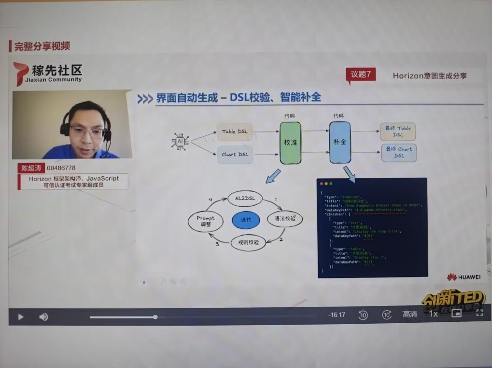
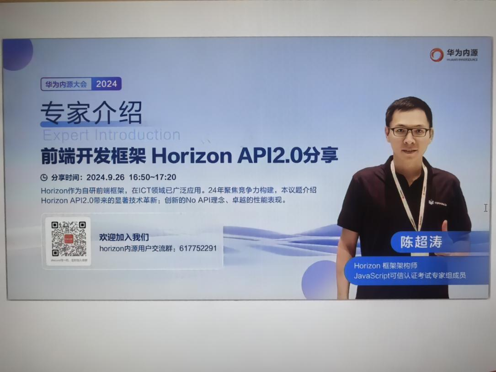
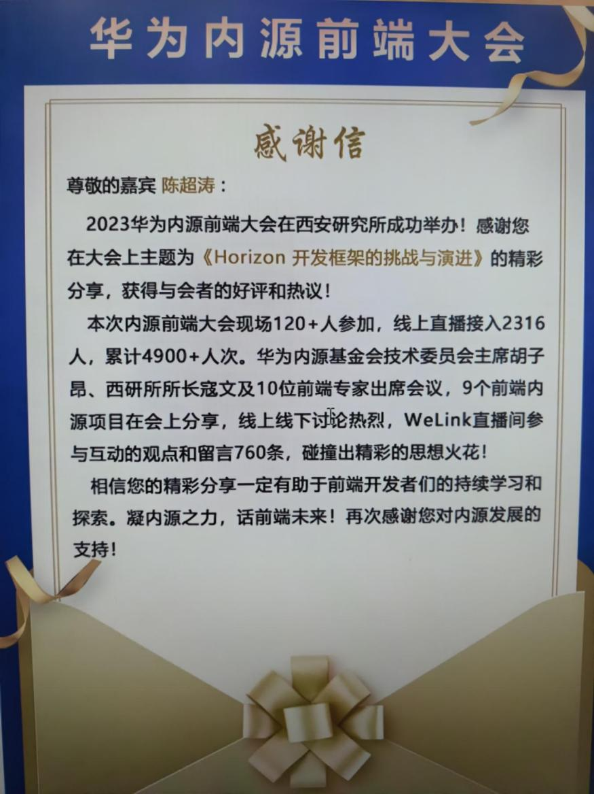
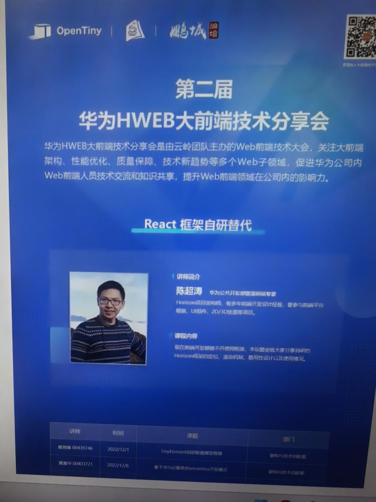
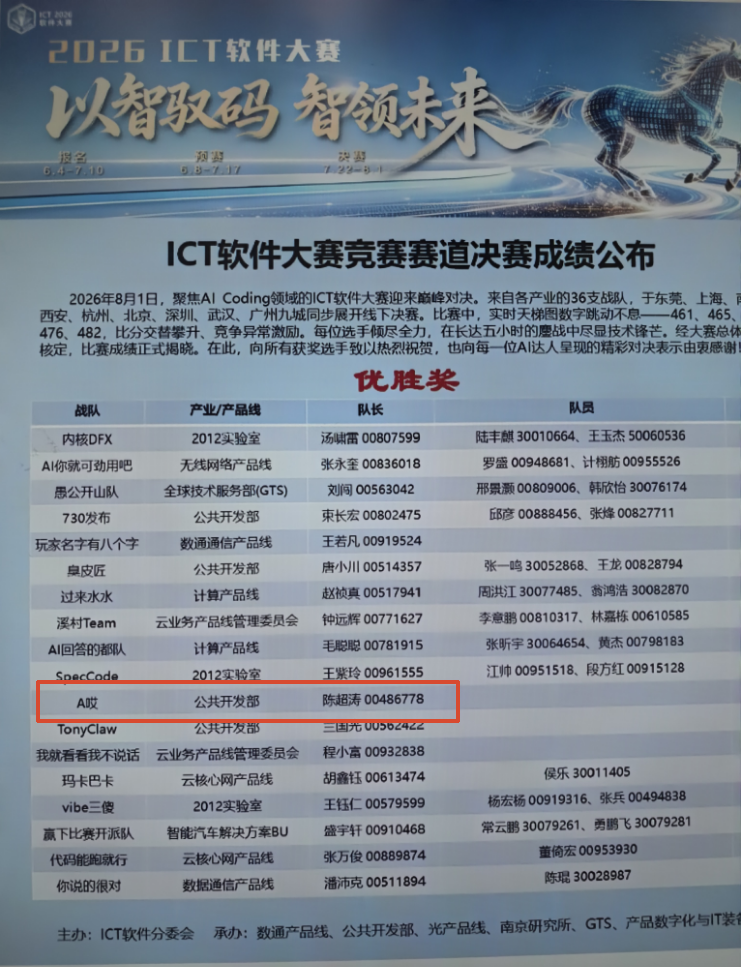

# chenchaotao-resume

**华为公司级内部技术分享（2022-2025）**：连续四年受邀在华为内部技术大会发表技术分享，议题聚焦前端架构演进与 AI 工程化实践。

- **2025年《AI时代下，前端开发提效的技术挑战和解决思路》公司分享：**

- **2024年华为内源大会分享：**

- **2023年华为内源分享：**

- **2022年HWEB大前端技术分享：**

  
**AI Coding 软件大赛优胜奖（2026 年 8 月）**：获得 ICT 部门（1w+ 人）AI Coding 软件大赛竞赛优胜奖（前 36 名）

 

